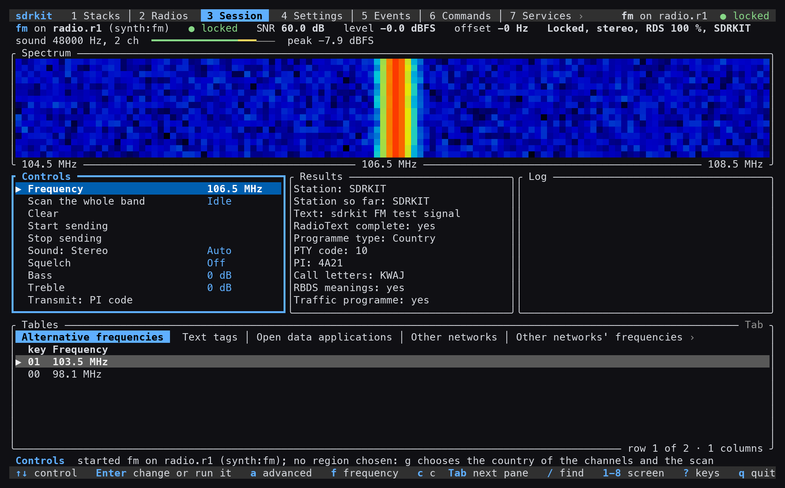

<h1 align="center">SDRkit</h1>

<p align="center"><b>One radio engine. Hundreds of protocols. A typed API for every language.</b></p>

<p align="center">
  
  
  
  
  
  
</p>

<div align="center">

  [](https://buymeacoffee.com/pacha)
  
</div>

sdrkit is a software-defined radio engine written in Rust. Point it at a radio, a recording or your own samples, name a
stack, and it gives you sound, pictures, video packets and decoded data: from FM with RDS and digital television to
aircraft, ships, weather satellites, digital voice, mesh networks and weak-signal modes. The same engine also
transmits on the radios and stacks that can.

It is one library with a small C API, typed bindings for Swift, C++ and Rust, a command-line tool and a terminal
application. It builds for iOS, macOS, Linux and Windows, and it has no copyleft dependency.

<p align="center">
  
</p>
<p align="center"><i><code>sdrkit-tui --stack fm --freq 106.5</code>: the terminal application on the FM test signal, with no radio.</i></p>

## Why sdrkit

- **One engine for every signal.** 311 stacks share one set of DSP, error-correction, modem and protocol crates.
  A stack is a graph of components, so a new protocol reuses what is already tested.
- **Runs without hardware.** Every stack has a test signal. `sdrkit run fm --source synth` plays FM with no radio, and
  the whole test suite runs on a laptop.
- **Made for applications.** Every object (the engine, a radio, a session, a stack, a service) declares its settings,
  results, events and commands. An application reads the declarations at run time, so one set of calls serves every
  stack and every radio. Lists are tables with row keys, and a snapshot returns only what changed.
- **A stable, typed API.** The C header, the Swift files and the docs pages are generated from one interface
  description with versions, in the way the Khronos Group publishes Vulkan. See
  [How the API is generated](#how-the-api-is-generated).
- **Real time on small machines.** The engine owns the threads, splits a heavy stack into stages over several cores,
  and uses NEON kernels on ARM. It runs digital television on a phone.
- **More than receive.** Several stacks can run at once on one radio. Services work on what the stacks decode: a
  recorder, a scanner, memories, a message store, a watch list, automation rules, feeds to other programs, a
  frequency database, sweeps, signal identification and a channel bank.
- **No regional guesswork in the engine.** Band plans and channel lists by country and ITU region are data files that
  the application reads and passes in as plain settings.

## Protocols and stacks

A stack is the chain of one technology, with its settings and its results.

| Area | Stacks |
|---|---|
| Broadcast radio | FM with RDS, DAB / DAB+, DRM, HamDRM, HD Radio, CDR, AM stereo (C-QUAM) |
| Television | DVB-T, DVB-T2, DVB-T or DVB-T2 on one frequency, DVB-C, DVB-S/S2, ISDB-T, ISDB-S, ATSC, ATSC 3.0, DTMB, automatic TV standard, satellite beacons, analogue TV (PAL, SECAM, NTSC, NICAM, teletext), MAC, FPV video |
| Aviation | ADS-B / Mode S, Mode S interrogations on 1030 MHz, UAT 978, Mode A/C, ACARS, VDL Mode 2 and 4, HFDL, SELCAL, airband voice |
| Navigation | GNSS (GPS, Galileo, GLONASS, BeiDou), SBAS, NDB, VOR, ILS, DME, Loran-C / eLoran, DGPS |
| Marine | AIS, VDES, marine VHF, ATIS, marine HF (DSC, NAVTEX, weather fax) |
| Weather satellites | Meteor-M LRPT, HRPT / AHRPT, GOES HRIT, GK-2A LRIT and HRIT, Elektro-L, FY-2 S-VISSR, FY-3 AHRPT and MPT, FY-4 LRIT and HRIT |
| Other satellites | Inmarsat-C, Inmarsat Aero, Inmarsat (all carriers), Iridium, Orbcomm, Globalstar, COSPAS-SARSAT, Argos, GOES DCS, CubeSat telemetry, LoRa satellites, QO-100, PSK demodulator |
| Digital voice | DMR, P25 Phase 1 and 2, NXDN, dPMR, TETRA, TETRAPOL, D-STAR, System Fusion, M17, FreeDV, DECT, automatic digital voice |
| Trunking and paging | MPT1327, LTR, EDACS, POCSAG, FLEX, Multitone, CTCSS, DCS, DTMF, selective calling |
| Weak-signal digital | FT8, FT4, FT2, WSPR, JT65, JT9, JT4, Q65, FST4, FST4W, MSK144, JS8, all of them at once |
| HF keyboard and picture | RTTY, PSK31, CW, Olivia, Contestia, MFSK, DominoEX, THOR, MT63, FSQ, IFKP, ROS, SSTV, Hellschreiber, SITOR, ARDOP |
| HF data | ALE, PACTOR I to IV, HF waveform identification, HF beacons, HF ocean radar, wave buoys |
| Packet, LoRa and mesh | APRS, LoRa APRS, MeshCom, Meshtastic, MeshCore, LoRaWAN (one channel or all), raw LoRa, all LoRa mesh networks at once |
| IoT and short range | 433/868 MHz sensors, Wireless M-Bus, Z-Wave, Zigbee, Wi-SUN, Sigfox, ANT+, nRF24, NFC 13.56 MHz, Sub-GHz chat, Bluetooth LE, BLE tracker detection, Wi-Fi networks, Wi-Fi HaLow |
| Cellular and rail | LTE, 5G NR and NB-IoT cell information, GSM / GSM-R, LBJ, Eurobalise |
| Drones | Drone Remote ID, DJI DroneID, FLARM |
| Science and time | Radiosondes, time signals, e-Czas, SAME weather alerts, meteor scatter, SSDV, radio astronomy, ionospheric sounders |
| Listening | General stack (AM, FM, SSB, CW) |

`sdrkit stacks` prints every stack with its id and group. [docs/index.md](docs/index.md) links a page for each stack
with its settings, results, tables, events and commands.

Transmit is off until the application turns on the one engine setting `transmit_allowed`, and `sdrkit drivers` shows
which radios can transmit.

## Supported radios

| Radio | Address |
|---|---|
| RTL-SDR dongle on a USB port of this computer | `usb:rtl:<selector>` |
| HackRF on a USB port of this computer | `usb:hackrf:<selector>` |
| PlutoSDR, ANTSDR and other radios with an IIO network daemon | `iiod:<host>` |
| RTL-SDR through `rtl_tcp` | `rtl_tcp:<host>:<port>` |
| SDRplay RSP through `rsp_tcp` or SDRconnect | `rsp_tcp:<host>:<port>`, `sdrconnect:<host>:<port>` |
| Hermes Lite 2 | `hermeslite2:<host>:<port>` |
| ANAN and other HPSDR radios, protocol 1 and protocol 2 | `hpsdr1:<host>:<port>`, `hpsdr2:<host>:<port>` |
| Red Pitaya | `redpitaya:<host>:<port>` |
| SpyServer, SDR++ server, SoapyRemote | `spyserver:<host>:<port>`, `sdrpp:<host>:<port>`, `soapyremote:<host>:<port>` |
| KiwiSDR, OpenWebRX | `kiwisdr:<host>:<port>`, `openwebrx:<host>:<port>` |
| Transceivers with TCI | `tci:<host>:<port>` |
| A recording (SigMF, WAV or raw IQ) | `file:<path>` |
| The test signal of a stack, with no radio | `synth:<stack>` |

The selector of a USB radio is empty for the first free device, or a serial number, `#<n>` or `@<bus>-<port path>`.
`sdrkit devices` lists the USB radios that are attached, without opening one. SDRplay devices are reached through the
network drivers today: `rsp_tcp`, SDRconnect or SoapyRemote on the computer that has the device.

| System | USB radios |
|---|---|
| macOS | Yes, with no setup. |
| Linux | Yes. A user who is not root needs a udev rule; the kernel television driver of a dongle is detached while the dongle is open. |
| Windows | Yes. An RTL-SDR dongle must be bound to the WinUSB driver once; a HackRF with recent firmware needs nothing. |
| Android | Through usbfs. An app without root rights gets a device only as a file descriptor from the system, and the library has no call that takes one yet. |
| iOS | No. Use a radio that another computer serves. |

Any open radio can also be served to the network: the engine's share sends its samples to `rtl_tcp` and SoapyRemote
clients beside the stacks that run here. [docs/serving.md](docs/serving.md) has the udev rule, the WinUSB step and the
share.

## Quick start

The workspace needs Rust 1.92 or newer.

```sh
git clone https://github.com/xls/sdrkit.git
cd sdrkit
cargo build --release          # or --profile dist: with whole-program optimisation
```

`target/release/sdrkit` is the command-line tool and `target/release/sdrkit-tui` the terminal application.

```sh
sdrkit stacks                                                         # list the stacks
sdrkit drivers                                                        # the radio drivers, their addresses, which transmit
sdrkit run fm --source synth --seconds 10                             # FM on its test signal, with no radio
sdrkit run fm --source iiod:192.168.2.1 --freq 104.9                  # FM on a PlutoSDR, with sound
sdrkit devices                                                        # the USB radios that are attached
sdrkit run fm --source usb:rtl: --freq 104.9                          # FM on the first free RTL-SDR dongle
sdrkit serve usb:rtl: --freq 104.9 --rate 2.4M --rtl-tcp 1234         # the dongle for rtl_tcp clients on port 1234
sdrkit run meshtastic --source iiod:192.168.2.1 --freq 919.875 --region AU
sdrkit play recording.sigmf-meta fm                                   # a recording through the FM stack
sdrkit-tui --stack fm                                                 # the terminal application
```

`--freq` takes a number in MHz. [docs/cli.md](docs/cli.md) describes every command and [docs/tui.md](docs/tui.md) the
terminal application, with its spectrum, waterfall, tables and settings.

## The API in your language

All bindings sit on one C library, `libsdrkit.a`, built by `crates/hosts/sdrkit-host-ffi`. Nothing crosses the API as
JSON: values are structs, enums and typed settings.

| Language | What you use | Where |
|---|---|---|
| C | `sdrkit.h` and one header per stack family (`sdrkit/fm.h`, `sdrkit/ais.h` ...) | [`crates/hosts/sdrkit-host-ffi/include`](crates/hosts/sdrkit-host-ffi/include) |
| C++ | The C headers, with a small RAII wrapper to copy | [`examples/cpp`](examples/cpp) |
| Swift | The package `SDRKit` (iOS 17, macOS 14): `Engine`, `Radio`, `Session`, `Snapshot` and typed files per family | [`apple/`](apple/README.md) |
| Rust | The crates `sdrkit-host-engine` and `sdrkit-host-catalog` | [`examples/rust`](examples/rust) |

The folder [`examples/`](examples/README.md) holds small programs to copy from: FM to a sound file, a table of
aircraft, the services of a DVB-T multiplex, Meshtastic messages, a band scan and saved settings.

### C

`crates/hosts/sdrkit-host-ffi` builds the static library `libsdrkit.a`. Its header is
[`crates/hosts/sdrkit-host-ffi/include/sdrkit.h`](crates/hosts/sdrkit-host-ffi/include/sdrkit.h).

```c
#include <stdio.h>
#include <unistd.h>
#include "sdrkit.h"

int main(void) {
    SDRKIT_HANDLE engine, radio, session, stack;
    if (sdrkit_engine_new(NULL, &engine) != SDRKIT_OK) /* NULL: files in memory */
        return 1;

    /* "synth:fm" is the FM test signal. A PlutoSDR is "iiod:192.168.2.1". */
    int32_t code = sdrkit_radio_open(engine, "synth:fm", NULL, &radio);
    if (code == SDRKIT_OK) {
        sdrkit_input input = sdrkit_input_radio(radio);
        sdrkit_stack_options options = {.centre_hz = 104.9e6};
        code = sdrkit_stack_start(engine, "fm", &options, &input, &session);
    }
    if (code != SDRKIT_OK) {
        sdrkit_string message;
        sdrkit_error_message(engine, &message);
        fprintf(stderr, "%s: %.*s\n", sdrkit_code_name(code), (int)message.len, message.ptr);
        sdrkit_free(engine);
        return 1;
    }
    sdrkit_object_stack(session, &stack); /* the results of the stack */

    float audio[9600];
    uint64_t counter = 0;
    for (int i = 0; i < 50; i++) {
        sdrkit_audio_info got;
        while (sdrkit_audio_read(session, audio, 9600, &got) == SDRKIT_OK && got.frames > 0) {
            /* got.frames frames of got.channels floats each, at got.rate_hz: play them. */
        }
        sdrkit_snapshot_info info;
        if (sdrkit_snapshot_read(stack, counter, &info) == SDRKIT_OK) {
            counter = info.counter; /* the next read copies only what changed */
            printf("%.*s, SNR %.1f dB\n", (int)info.summary.len, info.summary.ptr, info.snr_db);
        }
        usleep(100000);
    }

    sdrkit_session_stop(session);
    sdrkit_free(engine); /* stops every session and frees every handle of the engine */
    return 0;
}
```

```sh
cargo build --release -p sdrkit-host-ffi        # the library; add --target aarch64-apple-ios for iOS
cc -I crates/hosts/sdrkit-host-ffi/include example.c target/release/libsdrkit.a \
   -framework AudioToolbox -framework Accelerate -framework Security -framework CoreFoundation -framework IOKit
```

The `-framework` options are for Apple platforms: an application there links AudioToolbox, Accelerate, Security,
CoreFoundation and, on macOS, IOKit for the USB radios. The C programs in `crates/hosts/sdrkit-host-ffi/tests/` call
every part of the API.

The folder [`examples/`](examples/README.md) holds small programs in C, C++ and Rust to copy from. `sh tools/package.sh`
(`tools\package.ps1` on Windows) lays out an installed copy of the library with its headers, a pkg-config file and a
CMake package; [docs/building.md](docs/building.md) has the steps for each system.

### Swift

```swift
import SDRKit

let engine = try Engine()                              // or Engine(folder:) to keep settings
let radio = try engine.openRadio("synth:fm")           // a PlutoSDR is "iiod:192.168.2.1"
let session = try engine.start(stack: "fm", on: radio, frequency: 104.9e6)
let stack = try session.stack()
let snapshot = try stack.snapshot()                    // the results of the stack: station, radio text, SNR ...
```

`sh apple/build_xcframework.sh` builds the XCFramework that the package links. [apple/README.md](apple/README.md) has
the steps.

### Rust

A Rust program uses `sdrkit-host-engine` with the lists of `sdrkit-host-catalog`:

```rust
let mut facilities = sdrkit_host_engine::memory_facilities(); // or system_facilities(folder)
facilities.codecs = Arc::new(sdrkit_host_catalog::codecs());
let engine = Engine::new(Setup {
    components: sdrkit_host_catalog::registry(&facilities),
    facilities,
    transport: Arc::new(StdNet),
    stacks: sdrkit_host_catalog::all(),
    families: sdrkit_host_catalog::families(),
})?;
let defaults = |key: &str| -> Result<Values, EngineError> {
    Ok(Values::defaults(&engine.owner(engine.find(key)?, |o| Arc::clone(o.schema()))?))
};
let radio = engine.open_radio("synth", "fm", &defaults("driver.synth")?)?;
let session = engine.start_stack("fm", None, &defaults("stack.fm")?, Input::Radio(radio), None)?;
```

`Engine::audio`, `Engine::owner` and `Engine::take_events` then read the session. The C API is a layer over these calls.

## How the API is generated

sdrkit follows the model that the Khronos Group uses for Vulkan: one machine-readable description of the interface is
the source of truth, and every binding is written from it. Nobody edits a header by hand.

1. **You describe the interface once, in Rust.** The file `src/typed.rs` of a stack family holds its result fields,
   table rows, events, settings and commands as plain structs with `#[derive(Fields)]`. The field name is the key, the
   type is the kind, and the doc comment is the text that people read.
2. **The registry records it.** A test writes `registry/<family>.reg`: one line for each item with its type, its unit
   and the version in which it appeared. This is the same idea as `vk.xml`.
3. **The bindings are written from it.** The same step writes the C header `include/sdrkit/<family>.h`, the Swift file
   `swift/<Family>.swift`, the run-time declarations that an application can read, and the tables of the page
   `docs/stacks/<stack>.md`.
4. **Versions keep the API stable.** Each family has a version, such as `fm 1.2`. Adding an item raises the minor
   version. Changing or removing one needs a new major version. The test compares the interface with the registry
   record and fails on a change that the version does not permit, so a name cannot change by accident. An application
   compares `SDRKIT_<FAMILY>_VERSION_MAJOR` of its header with `sdrkit_family_version()` of the library.

The result is two ways to use the same data. A program that knows a stack uses the typed structs of its family. A
program that must serve every stack, such as the terminal application, reads the declarations and tables at run time
and needs no change when a stack is added. [docs/stack-interface.md](docs/stack-interface.md) is the full guide.

## Architecture

| Folder | Crates |
|---|---|
| `crates/framework` | `sdrkit-core` (settings, results, events, commands, the stack contract), `sdrkit-graph` (components and graphs), `sdrkit-components` (the standard components) |
| `crates/util` | Bits, text codes, identity tables, geodesy, tables of heard objects |
| `crates/algo` | DSP, error correction, modems, cryptography, channel simulation |
| `crates/proto` | Protocols that several stacks share: packet links, CCSDS, MPEG transport stream, LoRa, pagers, tones and others |
| `crates/codec` | Audio, speech and picture codecs |
| `crates/svc` | The services: recorder, scanner, memories, message store, watch list, automation, outputs and others |
| `crates/data` | Band plans by country and region |
| `crates/stacks` | One crate per family of stacks |
| `crates/drivers` | `sdrkit-driver-core` (the driver contract, test signal, file, `rtl_tcp`, `iiod`), `sdrkit-driver-usb` (the USB transport), one crate per other driver (among them `rtlusb` and `hackrf` on USB), and the driver list |
| `crates/serve` | The share's side of the network: the hub that feeds the clients, and the `rtl_tcp` and SoapyRemote servers |
| `crates/hosts` | The engine, the list of stacks and components, the C API, the command-line tool, the terminal application |
| `crates/dev` | Helpers for tests |

[ARCHITECTURE.md](ARCHITECTURE.md) describes the objects, the graph, the drivers, the engine and the C API.

## Extending

- A stack: make a crate under `crates/stacks/` with a `sdrkit_core::StackDescriptor`. Its `make_receiver` returns a
  `sdrkit_core::Receiver`, usually a `sdrkit_graph::StackGraph` of components. Add the descriptor to
  `sdrkit_host_catalog::all()` and the components to `sdrkit_host_catalog::registry()`.
- A driver: implement `sdrkit_driver_core::SourceDriver`. A network radio implements the `Radio` and `RadioStream`
  traits of `sdrkit_driver_core::runner`, and `StreamRunner` supplies the thread, the retries and the reconnect. Add the
  driver to `sdrkit_driver_registry::all()`.
- A codec: implement `sdrkit_core::codec::AudioCodec` and register its factory by four-character code in a `CodecSet`.
  Add the call to `sdrkit_host_catalog::codecs()`.
- An acceleration backend: implement the trait of the kernel family (`FftBackend`, `FirBackend`, `ResampleBackend`,
  `ViterbiBackend`, `RsBackend` or `LdpcBackend`) and add it to the `BACKENDS` table of the family, before the plain
  backend. `check_backend` of the family compares it with the plain backend.

## Testing

`cargo test --workspace` runs the tests of every crate. No radio is needed: each stack has a test signal, and
`sdrkit verify` runs each test signal through the engine with noise and a frequency offset. Recordings are kept outside
the repository: see [docs/testing.md](docs/testing.md).

## Documentation

- [ARCHITECTURE.md](ARCHITECTURE.md): the objects, the graph, the drivers, the engine and the C API.
- [docs/index.md](docs/index.md): the settings, results, events and commands of each stack and each driver.
- [docs/building.md](docs/building.md) and [docs/packaging.md](docs/packaging.md): builds and installed copies for
  each system.
- [docs/serving.md](docs/serving.md): USB radios, their setup on each system, and the share that serves a radio to the
  network.
- [docs/benchmarks.md](docs/benchmarks.md): the benchmarks. [docs/schema/](docs/schema): the JSON Schema of the plan
  files.
- [CONTRIBUTING.md](CONTRIBUTING.md): how to add to the project. [THIRD_PARTY.md](THIRD_PARTY.md): the licences of
  the dependencies.

## License

[MIT](LICENSE). Copyright © 2026 Thomas Rizos.

Decode only signals that are openly broadcast. Decode encrypted services only with keys that you are entitled to use.
Transmit only where your licence and the rules of your country allow it.
